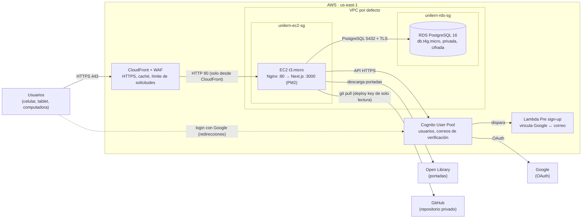

# Arquitectura de UniLern (UniTec)

**UniLern** es la plataforma de reseñas de libros de la universidad ficticia **UniTec**. Estudiantes y docentes inician sesión con Google o con correo y contraseña, califican cada libro del 1 al 10 y dejan su opinión. La nota de cada libro es el promedio de las reseñas. El equipo de TI administra el catálogo de 100 libros.

La solución corre en **AWS** (región `us-east-1`, N. Virginia), dentro de la capa gratuita, y se accede desde cualquier dispositivo (diseño responsive).

- **Sitio:** https://d17jpgxptydxb5.cloudfront.net
- **Código:** https://github.com/Kmayen20/unilern (privado)

## Diagrama

## Componentes

| Componente | Recurso en AWS / servicio | Para qué sirve |
|---|---|---|
| **CloudFront** | Distribución `E2YXN0CYLZQYWG` (`d17jpgxptydxb5.cloudfront.net`), plan gratuito | Puerta de entrada pública. Da **HTTPS** sin dominio propio (Cognito y Google exigen HTTPS en las direcciones de retorno), redirige HTTP a HTTPS, guarda en caché los archivos estáticos (`/_next/static/*`) y no cachea las páginas dinámicas. |
| **AWS WAF** | Web ACL creada por CloudFront (incluida en el plan gratuito) | Firewall de aplicación: protecciones básicas y **límite de solicitudes por IP** contra inundaciones (DoS) y fuerza bruta en los logins. |
| **EC2** | `i-04a8f2894cfa869b4` (`unilern-ec2`), t3.micro, Amazon Linux 2023, disco gp3 de 16 GB cifrado | Servidor de la aplicación. **Nginx** recibe en el puerto 80 y pasa las peticiones a **Next.js** en `127.0.0.1:3000`. **PM2** mantiene Next.js corriendo y lo levanta al reiniciar. Tiene 2 GB de swap porque la compilación no cabe en 1 GB de RAM. |
| **Aplicación** | Next.js 15 + Prisma + Auth.js | Catálogo, detalle con reseñas, formularios de cuenta y panel de administración. Valida todo en el servidor (zod) y consulta la base con consultas parametrizadas (Prisma). |
| **RDS PostgreSQL** | `unilern-db`, PostgreSQL 16, db.t4g.micro, Single-AZ, 20 GB | Base de datos: tablas `Book` y `Review`. La calificación no se guarda: se calcula con `AVG(rating)`. **Privada** (sin acceso desde Internet), **cifrada** y con **respaldos automáticos de 7 días**. |
| **Cognito** | User Pool `us-east-1_I1oVzy2Af`, app client `unilern-web`, dominio `unilern-unitec` | Directorio de usuarios: registro con correo y contraseña (código de verificación de 6 dígitos), recuperación de contraseña, política de contraseña fuerte e inicio de sesión con Google. |
| **Lambda** | `unilern--vincular-cuentas` (Node.js 22) | Disparador *Pre sign-up* de Cognito: si alguien entra con Google y ya tenía cuenta confirmada con el mismo correo, **vincula** ambas identidades para que sea un solo usuario. Su rol solo puede listar usuarios y vincular cuentas en ese pool. |
| **Google OAuth** | Proyecto `unilern` en Google Cloud, en modo Prueba | Proveedor de identidad para "Continuar con Google". Solo los usuarios de prueba registrados pueden entrar mientras siga en modo Prueba. |
| **Open Library** | API pública (sin key) | Origen de las portadas de los libros (`covers.openlibrary.org`). |
| **GitHub** | Repositorio privado `Kmayen20/unilern` | Código fuente. EC2 lo descarga con una **deploy key de solo lectura**. |
| **AWS Budgets** | `infogames-zero` (zero spend) | Avisa por correo con el primer centavo de gasto. |

## Flujos principales

1. **Visitante:** navegador → CloudFront (HTTPS) → EC2 (Nginx → Next.js) → RDS. Las portadas se descargan de Open Library a través del optimizador de imágenes de Next.js.
2. **Registro con correo:** la app llama a la API de Cognito desde el servidor (`SignUp`), Cognito envía el código por correo, el usuario lo escribe (`ConfirmSignUp`) y luego inicia sesión (`InitiateAuth`).
3. **Login con Google:** la app redirige a Cognito (`/oauth2/authorize` con `identity_provider=Google`), Cognito redirige a Google, Google vuelve a Cognito y Cognito vuelve a la app con un código. La app lo canjea y valida el token (PKCE, `state` y `nonce`). La primera vez, la Lambda vincula la cuenta si ya existía con ese correo.
4. **Reseña:** el usuario con sesión envía el formulario. El servidor verifica la sesión, valida nota (1–10) y opinión (máx. 1000), y guarda o actualiza **una reseña por usuario y libro**.
5. **Administrador:** entra en `/admin/login` con credenciales definidas en el servidor (no en Cognito; la contraseña se guarda como hash bcrypt). El middleware protege `/admin/*` y cada acción vuelve a verificar el rol.
6. **Despliegue:** en EC2, `deploy/update.sh` descarga la última versión de GitHub, instala dependencias, aplica migraciones, compila y reinicia con PM2.

## Segmentación de red

| Grupo de seguridad | Entrada permitida | Motivo |
|---|---|---|
| `unilern-ec2-sg` | HTTP 80 solo desde la lista de prefijos de CloudFront (`pl-3b927c52`) | Nadie puede saltarse CloudFront ni WAF para llegar al servidor. |
| | SSH 22 solo desde la IP del equipo | Administración del servidor. |
| `unilern-rds-sg` | PostgreSQL 5432 solo desde `unilern-ec2-sg` | Solo el servidor de la app habla con la base de datos. |

Comprobado: el servidor no responde si se le habla directo, sin CloudFront, y RDS no es accesible desde Internet.

## Controles de seguridad

**Implementados** (detalle y evidencias en `docs/controles.md`):
- HTTPS con CloudFront y redirección de HTTP.
- WAF con límite de solicitudes.
- Segmentación con Security Groups.
- RDS privada.
- Cifrado en reposo en RDS y en el disco de EC2.
- Respaldos automáticos de RDS.
- IMDSv2 obligatorio en EC2.
- Política de contraseña fuerte y verificación de correo en Cognito.
- Vinculación segura de identidades.
- Secretos fuera del repositorio.
- Validación y consultas parametrizadas.
- Control de acceso al panel de administración en dos capas.
- Hash bcrypt de la credencial de administrador.
- Alerta de gasto.

**Diseñados, no implementados** (por costo o por decisión del equipo):
- MFA para usuarios y para la cuenta de AWS.
- Usuario IAM en vez de root.
- CloudTrail, alarmas y SIEM.
- Protecciones WAF de pago (SQL, DDoS de capa 7).
- Alta disponibilidad (Multi-AZ, varias instancias).
- EDR, MDM y DLP.
- Cifrado HTTPS entre CloudFront y EC2.

Los riesgos asociados están en `docs/riesgos.md`.

## Operación y costos

- **Todo dentro de la capa gratuita:** una instancia t3.micro, una base db.t4g.micro, discos de 16 y 20 GB, CloudFront y WAF en el plan gratuito, Cognito Essentials (hasta 10 000 usuarios activos al mes) y Lambda con pocas invocaciones.
- **Apagar y encender** desde la Mac: `bash deploy/stop.sh` y `bash deploy/start.sh`. El script de encendido actualiza el origen de CloudFront, porque el DNS público de EC2 cambia en cada encendido. RDS apagada se vuelve a encender sola a los 7 días.
- **Actualizar la app:** subir los cambios a `main` y, en el servidor, correr `bash ~/unilern/deploy/update.sh`.
- **Límites conocidos:**
  - El correo por defecto de Cognito envía unos 50 correos al día.
  - Google solo deja entrar a los usuarios de prueba mientras la app esté en modo Prueba.
  - No hay alta disponibilidad: si la instancia o la base fallan, el sitio queda fuera de servicio hasta recuperarlas.
